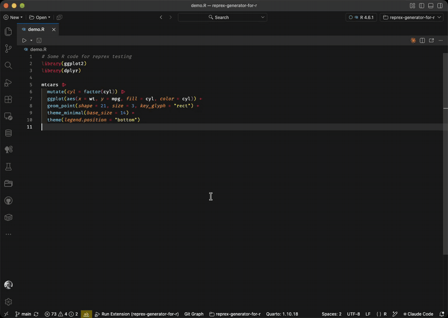

# Reprex Generator for R

[](https://open-vsx.org/extension/jemus42/reprex-generator-for-r)
[](https://open-vsx.org/extension/jemus42/reprex-generator-for-r)
[](LICENSE.md)

A [Positron](https://positron.posit.co/) / VS Code extension that brings the [`{reprex}`](https://reprex.tidyverse.org/) package to your editor. If you're an
R user who relies on `reprex::reprex()` or the RStudio addin to create reproducible examples for GitHub issues, Stack Overflow, or Slack, this extension lets you do the same thing without leaving Positron or VS Code.



## Features

All commands are available via the Command Palette (`Cmd+Shift+P` / `Ctrl+Shift+P`)
under the **Reprex** category:

| Command                                     | Description                                                      |
| ------------------------------------------- | ---------------------------------------------------------------- |
| **Reprex: Start Addin**                     | Launch the interactive `reprex_addin()` in your R console        |
| **Reprex: Active File**                     | Create a reprex from the entire active file                      |
| **Reprex: Selected Code**                   | Create a reprex from the current selection                       |
| **Reprex: Active File (Choose Venue)...**   | Like above, but pick the venue (GitHub, Slack, ...) for this run |
| **Reprex: Selected Code (Choose Venue)...** | Like above, but pick the venue (GitHub, Slack, ...) for this run |
| **Reprex: Clipboard**                       | Create a reprex from the code on your clipboard                  |

The venue used by the plain commands is set via `reprex.venue`.

The rendered reprex output is:

- Opened in an editor beside your code
- Automatically copied to your clipboard (when possible)

Plots are saved per run under the location set by `reprex.outputLocation`: the user cache directory (default), `.reprex/` in the workspace (which ignores itself in git), or a custom path via `reprex.outputPath`.

### Plots

By default `{reprex}` uploads plots anonymously to [imgur](https://imgur.com/) and puts the image URL in the output, for every venue except `r`.
The image is then publicly reachable, so avoid plotting sensitive data.
The local copy is kept in the output location above either way.

To keep plots local, disable `reprex.uploadPlots`.
The output then refers to the plot by a relative path such as `<name>_reprex_files/figure-gfm/unnamed-chunk-2-1.png`, which does not exist where you paste it.
Attach the PNG from the output location yourself; the extension shows its path after each run that produced plots.
The `r` venue always behaves this way.

Saved figures older than `reprex.keepFiguresDays` (default 30) are removed automatically.

### Other settings

- `reprex.sessionInfo`, `reprex.advertise`, `reprex.style` and `reprex.comment` pass the matching `reprex()` options through. Left on `default`, reprex's own defaults and any `reprex.*` option from your `.Rprofile` apply.
- `reprex.timeoutSeconds` stops a reprex that runs too long (default 600, `0` disables).
- `reprex.copyToClipboard` controls whether the result is copied automatically.

## Requirements

- **R** must be installed. In Positron the extension uses the R interpreter you have selected; otherwise it uses `Rscript` from your `PATH`, or the path in `reprex.rscriptPath`
- The **[reprex](https://reprex.tidyverse.org/)** package must be installed:
  ```r
  install.packages("reprex")
  # or
  pak::pak("reprex")
  ```

## Security

A reprex runs R code, so only use it on code and in workspaces you trust.

- The extension is disabled in untrusted workspaces, and each run checks workspace trust again.
- R starts in the directory of the file you run, so a `.Rprofile` or `.Renviron` there is executed, as it would be in an R console.
  This is what lets reprexes see an `renv` project library, but it also means you should not run reprexes from folders you do not trust.
- **Reprex: Clipboard** shows the code and asks before running it.
- `reprex.rscriptPath` and `reprex.outputPath` can only be set in user settings, not in a workspace's `.vscode/settings.json`, so a repository cannot point the extension at its own executable.
- The `gh`, `so`, `ds`, `slack` and `html` venues upload plots to imgur by default, see [Plots](#plots).
- R is started without a shell, so file names and settings cannot inject commands.

## Installation

Install from [Open VSX](https://open-vsx.org/extension/jemus42/reprex-generator-for-r)
by searching for "Reprex Generator" in the extensions panel, or from the command
line:

```sh
# Positron
positron --install-extension jemus42.reprex-generator-for-r

# VS Code
code --install-extension jemus42.reprex-generator-for-r
```

## Known Issues

- The extension prioritizes Positron's console API. On plain VS Code it falls
  back to the [vscode-R](https://github.com/REditorSupport/vscode-R) extension
  or clipboard-based workarounds.
- The "Start Addin" command runs `reprex_addin()` which blocks the R console
  until the addin is closed.

## Development

Prerequisites: [Node.js](https://nodejs.org/), [pnpm](https://pnpm.io/),
[just](https://github.com/casey/just).

```sh
# Install dependencies
just install

# Compile (esbuild)
just compile

# Watch mode for development
just watch

# Bundle into .vsix and install locally (Positron + VS Code)
just install-extension

# Lint
just lint

# Run tests
just test
```

See the `Justfile` for all available tasks.

## License

[MIT](LICENSE.md)
